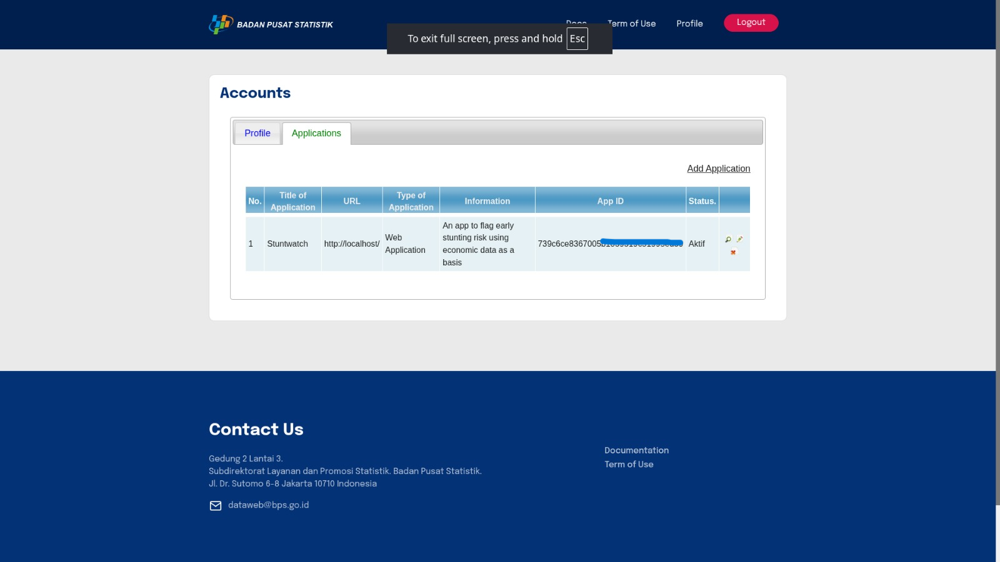

# Data source reference

The following image documents the BPS API source used by the project:

The reproducible input filenames, schemas, and local-data requirements are
listed in [`data/raw/README.md`](../data/raw/README.md).
